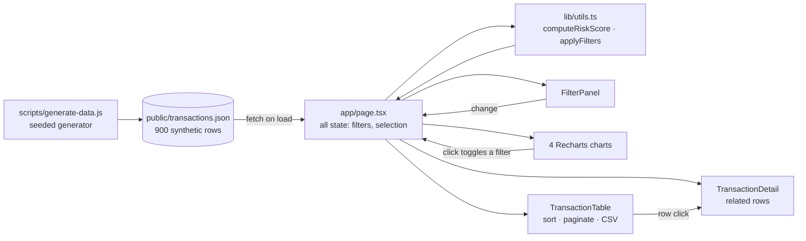

# Transaction Pattern Explorer

[](https://github.com/Nityaa08/fraud-pattern-explorer/actions/workflows/ci.yml)

**Live demo: [fraud.nityashree.in](https://fraud.nityashree.in)** · by [Nityashree S](https://nityashree.in)

A frontend-only fraud analytics dashboard that helps risk analysts find fraud patterns in a set of transactions: rule-based pattern cards with one-click drill-down, linked filters, chart-click filtering and a detail panel that explains each risk score. It runs on 900 synthetic transactions with one planted pattern.

[](https://fraud.nityashree.in)

## In 60 seconds

| | |
|---|---|
| **The problem** | A fraud attack hides inside normal traffic. An analyst needs to get from "something is off" to "these 50 rows" fast, and needs to trust that the alerts are real. |
| **What I built** | A Next.js dashboard where fixed rules flag suspicious patterns, every chart doubles as a filter, and each row explains its own risk score. A three-step tour at the top of the page shows the attack, opens the riskiest row and resets. |
| **How I know it works** | The rules are scored against an answer key of the 50 planted rows (`public/planted.json`) that the rules never read. The scorecard is on the page and in the table below. |
| **Engineering** | TypeScript, React state in one component, Recharts, Tailwind. 65 Vitest tests including five time zones and a daylight-saving day. CI runs type-check, lint, tests and build on every push. |

**Rule scorecard** (seed-42 data, checked by `tests/scorecard.test.ts`):

| Rule | Flags | Of them planted | Precision | Recall |
|---|---|---|---|---|
| Chargeback burst (Brazil, 2-hour window) | 51 | 50 | 98% | 100% |
| Customer emails with 3+ chargebacks | 50 | 50 | 100% | 100% |
| IP ≠ billing country | 50 | 50 | 100% | 100% |
| Chargebacks over 3x the average | 20 | 20 | 100% | 40% |
| Risk score 70+ | 50 | 50 | 100% | 100% |

These numbers are high because the data is generated and clean: in this dataset only planted rows have an IP mismatch, so that rule is perfect by construction. They show that the rules and the UI find what was planted, not how the rules would do on real traffic. The high-amount rule is the useful counter-example: precise, but it finds only 40% of the attack on its own.

## Why

An analyst who suspects an attack needs to move from "something is off" to "these 50 rows" quickly. The first pattern card does that in one click; every chart is also a filter, so a click on the red chargeback spike narrows the whole dashboard to that hour, and the detail panel shows the shared signals (IP country, card range, email). Try it on the live demo: the planted pattern is described under [Embedded Fraud Pattern](#embedded-fraud-pattern).

## Architecture



No backend: the data is a static JSON file, and filtering, scoring and charting all run in the browser. State lives in one component and flows down; chart clicks and filter changes flow back up.

## Quick Start

```bash
npm install
npm run dev
```

Open [http://localhost:3000](http://localhost:3000).

## Regenerate Test Data

```bash
node scripts/generate-data.js        # seed 42, reproduces the committed file
node scripts/generate-data.js 7      # any other seed gives a different dataset
```

This generates 900 transactions in `public/transactions.json` with an embedded fraud pattern.

## Tests

```bash
npm test          # vitest: 65 tests
npm run lint
npm run build
```

The tests cover the time-chart hour buckets and the From/To date pickers in five time zones (UTC, India, Brazil, Nepal, US Pacific, including a 23-hour daylight-saving day), related-transaction matching, the rule scorecard (precision and recall arithmetic, and the scores of every rule against the answer key), the suspicious-pattern rules (the planted burst and the 5 repeat-chargeback emails are found, and every pattern's filter shows as many rows as it reports), one risk threshold across views, gap-filled hourly series, active-filter tags, amount buckets, the amount boxes (a cleared box means no limit, not $0), table sorting, the CSV export (cells that a spreadsheet would run as formulas are neutralised, and every row reads back to the same values), and the generator (reproducible, country-consistent payment methods and merchants, planted pattern intact). All three commands passed on 2026-11-23.

## Deploy to Vercel

The live demo is a Vercel project linked to this repository; every push to `main` deploys it. To deploy your own copy, import the repository at [vercel.com/new](https://vercel.com/new) (Next.js is detected automatically, no environment variables are needed).

## Tech Stack

- Next.js 14 (App Router)
- TypeScript
- Tailwind CSS
- Recharts
- date-fns

## Features

- **A 60-second tour and a rule scorecard** at the top of the page: what the dashboard is for, three buttons that show the attack, open the riskiest row and reset, and each rule's precision and recall against the answer key.
- **Suspicious patterns with one-click drill-down**: four fixed rules (a 2-hour chargeback burst per country, customers with 3+ chargebacks, IP/billing country mismatches, chargebacks over 3x the average amount). Each card has a "Show these N" button that applies the filters for exactly its rows.
- **Every chart is a filter**: click an hour in the time chart, or a row in the country, payment-method or amount breakdowns. Each chart shows the data filtered by everything except its own dimension, so a selected bar stays next to the others and a second value can be added.
- **Colour means risk**: neutral greys for volume, red only for chargebacks and high risk, amber for medium risk. Breakdown bars show the chargeback share in red and the chargeback rate beside each count.
- **Active-filter tags** for every filter, including date and amount ranges, each removable on its own.
- **Filters**: search, high-risk and IP-mismatch switches, status, country, payment method, amount and local-time dates. A sidebar on wide screens, a collapsible card on phones.
- **Risk scoring**: each transaction gets a 0–100 score from 6 hand-weighted signals (see Data). The detail panel lists the signals and their points.
- **Sortable transaction table** (highest risk first by default) with pagination and CSV export of the filtered rows. Rows open with a click, or with Enter when focused.
- **Detail panel** as an accessible dialog (Escape closes it, focus returns to the row) with the risk breakdown, IP mismatch, card, and related transactions (same customer email, or for card payments the same card BIN and last 4).

## Embedded Fraud Pattern

50 high-value chargebacks ($400–$780) from Brazil via Visa, all in a 2-hour window (Feb 24, 02:00–04:00 UTC), targeting Electronics. IP addresses originate from Nigeria, Russia, and China — a clear billing/IP country mismatch. Transactions use clustered card numbers (70xx range) and repeat from 5 suspicious email addresses. The pattern can be found from the first suspicious-pattern card, the red spike in the hourly chart, or the High Risk filter. Time to discovery has not been measured with users.

## Data

- `public/transactions.json` holds 900 **synthetic** transactions made by `scripts/generate-data.js`. No real customer data is used.
- `public/planted.json` is the answer key: the IDs of the 50 planted rows, written by the same generator. Only the scorecard reads it; the rules and the risk score never do.
- The generator plants one fraud pattern (below). Normal rows always have an IP country equal to the billing country; planted rows never do.
- Payment methods match the customer's country: Brazil uses Visa, Mastercard, PIX and Boleto; Mexico uses Visa, Mastercard, OXXO and SPEI; Colombia uses Visa, Mastercard, PSE and Efecty. Merchants are in the customer's country.
- The risk score gives its largest weight (+40) to an IP/country mismatch, so it is **tuned to the planted pattern**. The High Risk filter (score 70 or more) flags exactly the 50 planted rows (checked 2026-11-14 on the seed-42 data). This shows the UI works; it does not show that the rules would detect real fraud.
- The score also uses chargebacks, which arrive after a payment, so it is an exploration aid, not a pre-authorisation fraud model.
- The generator uses a seeded random generator (seed 42 by default), so re-running it reproduces the committed file.

## Known Issues (checked 2026-11-16)

Fixed on 2026-11-16: the CSV export could run attacker-chosen formulas. A customer email such as `=HYPERLINK("http://evil.example","Click")` is chosen by whoever placed the order, and the export only quoted it, so Excel or Sheets would treat it as a formula when an analyst opened the file. Text cells that start with `=`, `+`, `-`, `@`, a tab or a carriage return now get a leading `'` (the OWASP CSV-injection guidance), numbers stay numeric, and rows end with CRLF as RFC 4180 expects.

Fixed on 2026-11-02: the time-chart click now filters the hour that was clicked in the viewer's time zone (including half-hour zones such as India); "related transactions" no longer links PIX, Boleto, OXXO, SPEI, PSE or Efecty rows through the `N/A` card placeholder; the generator no longer gives Colombia PIX or Boleto and picks merchants from the customer's country.

Fixed on 2026-11-14:
- The chargeback-burst rule never flagged the planted attack. It measured the span of *all* of a country's chargebacks, and Brazil's 25 ordinary chargebacks spread over the week, so the 2-hour burst never fit a 4-hour span. It is now a 2-hour sliding window, and it flags 51 chargebacks from Brazil (the 50 planted ones plus one ordinary chargeback in the same two hours).
- "Emails with 5+ transactions" flagged 87 of 203 customers, which is noise. It is now customers with 3 or more chargebacks, which finds exactly the 5 planted emails.
- High Risk Only used a score of 50 or more while the table called 40–69 "Medium", so a row scored 55 appeared under High Risk Only labelled Medium. All views now use one threshold (70).
- The time chart skipped hours with no transactions, so quiet periods were squeezed; empty hours are now zeros.
- A time-chart click or an amount range changed the view without showing an active-filter tag. Every active filter now has a removable tag.

Fixed on 2026-11-12: the From/To date pickers filter whole calendar days in the viewer's time zone (they used UTC days, so an analyst in India picking Feb 24 got rows from 05:30 IST Feb 24 to 05:29 IST Feb 25), and after a time-chart click they show the local day of the selected hour.

- **All amounts are in USD.** Brazilian, Mexican and Colombian payments are generated and shown in USD, not BRL, MXN or COP.
- **The risk score is tuned to the planted pattern** (see Data), so the dashboard shows the exploration workflow, not a fraud model.

The live site is deployed by Vercel from `main` on every push (checked 2026-11-13: the production deployment matches the latest commit).

---

Built by [Nityashree S](https://nityashree.in) · [GitHub](https://github.com/Nityaa08)
