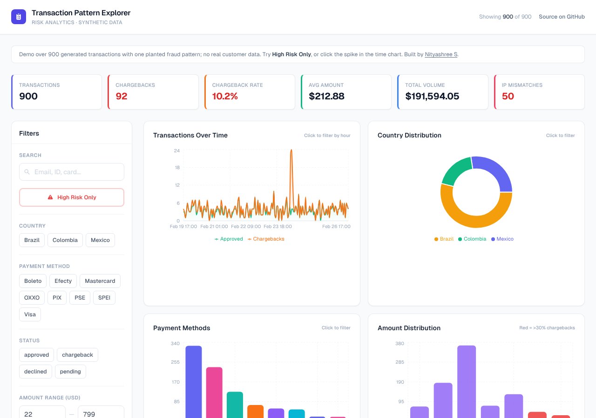
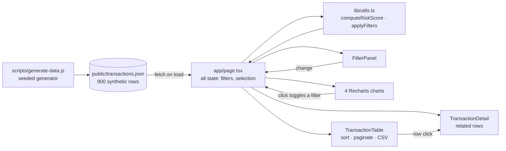

# Transaction Pattern Explorer

**Live demo: [fraud-pattern-explorer.vercel.app](https://fraud-pattern-explorer.vercel.app)** · by [Nityashree S](https://nityashree.in)

A frontend-only fraud analytics dashboard that helps risk analysts visually find fraud patterns in a set of transactions: linked filters, chart-click drill-down, rule-based risk flags and a detail panel. It runs on 900 synthetic transactions with one planted pattern.

[](https://fraud-pattern-explorer.vercel.app)

## Why

An analyst who suspects an attack needs to move from "something is off" to "these 50 rows" quickly. Every chart here is also a filter, so one click on the chargeback spike narrows the whole dashboard to that hour; the High Risk toggle and the detail panel then show the shared signals (IP country, card range, email). Try it on the live demo: the planted pattern is described under [Embedded Fraud Pattern](#embedded-fraud-pattern).

## Architecture



No backend: the data is a static JSON file, and filtering, scoring and charting all run in the browser. State lives in one component and flows down; chart clicks and filter changes flow back up.

## Quick Start

```bash
npm install
npm run dev
```

Open [http://localhost:3000](http://localhost:3000).

## Regenerate Test Data

```bash
node scripts/generate-data.js        # seed 42, reproduces the committed file
node scripts/generate-data.js 7      # any other seed gives a different dataset
```

This generates 900 transactions in `public/transactions.json` with an embedded fraud pattern.

## Tests

```bash
npm test          # vitest: 27 tests
npm run lint
npm run build
```

The tests cover the time-chart hour buckets and the From/To date pickers in five time zones (UTC, India, Brazil, Nepal, US Pacific, including a 23-hour daylight-saving day), related-transaction matching, and the generator (reproducible, country-consistent payment methods and merchants, planted pattern intact). All three commands passed on 2026-11-12.

## Deploy to Vercel

The live demo is a Vercel project linked to this repository; every push to `main` deploys it. To deploy your own copy, import the repository at [vercel.com/new](https://vercel.com/new) (Next.js is detected automatically, no environment variables are needed).

## Tech Stack

- Next.js 14 (App Router)
- TypeScript
- Tailwind CSS
- Recharts
- date-fns

## Features

- **Multi-dimensional filtering**: Country, payment method, status, amount range, date range, text search, high-risk toggle
- **4 interactive charts**: Time series, country distribution, payment method, amount histogram
- **Chart-click filtering**: Click any chart segment to filter the entire dashboard instantly
- **Suspicious Patterns Panel**: rule-based pattern flags (fixed thresholds) for chargeback clusters, IP mismatches, email velocity and high-amount outliers
- **Risk scoring**: each transaction gets a 0–100 score from 6 hand-weighted signals (see Data)
- **Sortable transaction table** with pagination, risk indicators, and CSV export
- **Slide-out detail panel** with full transaction info, IP mismatch alerts, and related transactions (same customer email, or for card payments the same card BIN and last 4)
- **Summary stats bar** showing chargebacks, rates, and IP mismatches

## Embedded Fraud Pattern

50 high-value chargebacks ($400–$780) from Brazil via Visa, all in a 2-hour window (Feb 24, 02:00–04:00 UTC), targeting Electronics. IP addresses originate from Nigeria, Russia, and China — a clear billing/IP country mismatch. Transactions use clustered card numbers (70xx range) and repeat from 5 suspicious email addresses. The pattern can be found by observing the time series spike, filtering by chargebacks, or using the High Risk toggle. Time to discovery has not been measured with users.

## Data

- `public/transactions.json` holds 900 **synthetic** transactions made by `scripts/generate-data.js`. No real customer data is used.
- The generator plants one fraud pattern (below). Normal rows always have an IP country equal to the billing country; planted rows never do.
- Payment methods match the customer's country: Brazil uses Visa, Mastercard, PIX and Boleto; Mexico uses Visa, Mastercard, OXXO and SPEI; Colombia uses Visa, Mastercard, PSE and Efecty. Merchants are in the customer's country.
- The risk score gives its largest weight (+40) to an IP/country mismatch, so it is **tuned to the planted pattern**. The High Risk toggle flags 51 rows, 50 of them planted (checked 2026-11-02 on the seed-42 data). This shows the UI works; it does not show that the rules would detect real fraud.
- The score also uses chargebacks, which arrive after a payment, so it is an exploration aid, not a pre-authorisation fraud model.
- The generator uses a seeded random generator (seed 42 by default), so re-running it reproduces the committed file.

## Known Issues (checked 2026-11-12)

Fixed on 2026-11-02: the time-chart click now filters the hour that was clicked in the viewer's time zone (including half-hour zones such as India); "related transactions" no longer links PIX, Boleto, OXXO, SPEI, PSE or Efecty rows through the `N/A` card placeholder; the generator no longer gives Colombia PIX or Boleto and picks merchants from the customer's country.

Fixed on 2026-11-12: the From/To date pickers filter whole calendar days in the viewer's time zone (they used UTC days, so an analyst in India picking Feb 24 got rows from 05:30 IST Feb 24 to 05:29 IST Feb 25), and after a time-chart click they show the local day of the selected hour.

- **All amounts are in USD.** Brazilian, Mexican and Colombian payments are generated and shown in USD, not BRL, MXN or COP.
- **The risk score is tuned to the planted pattern** (see Data), so the dashboard shows the exploration workflow, not a fraud model.

The live site is deployed by Vercel from `main` on every push (checked 2026-11-13: the production deployment matches the latest commit).

---

Built by [Nityashree S](https://nityashree.in) · [GitHub](https://github.com/Nityaa08)
